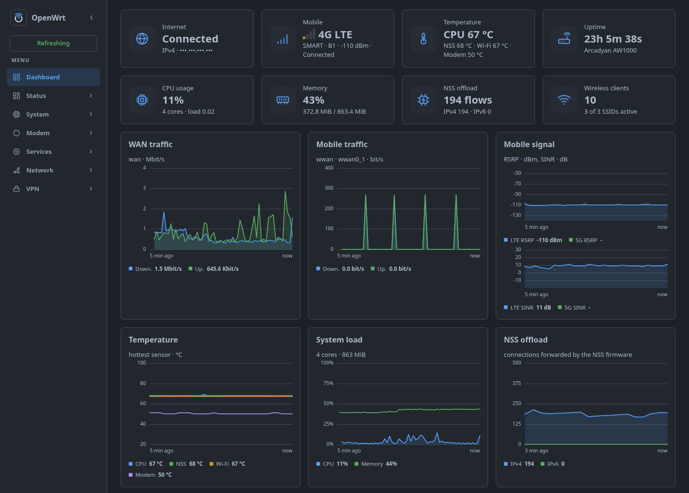
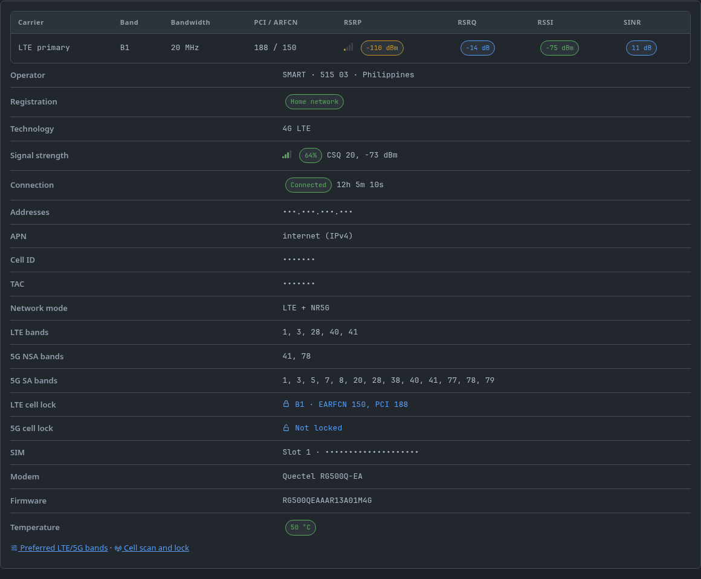
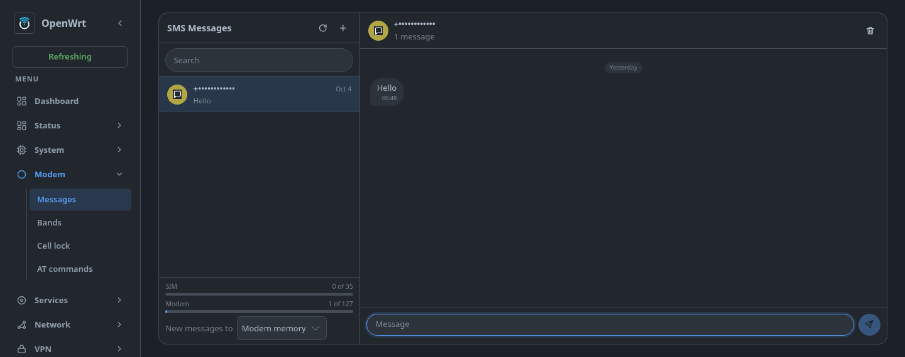
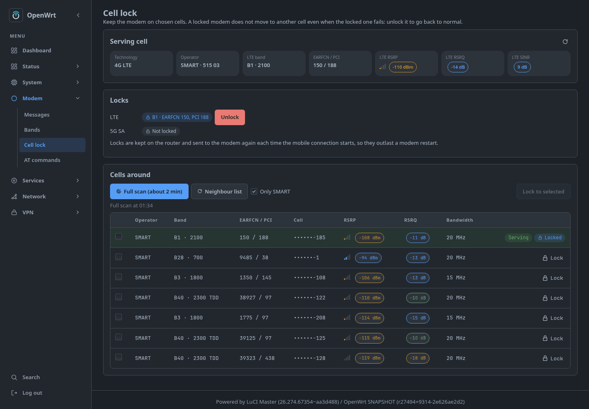
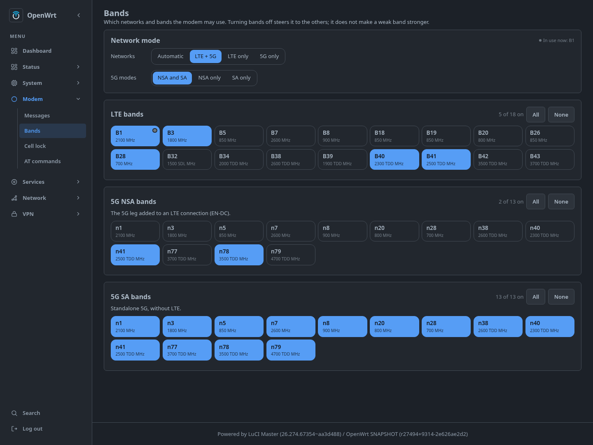
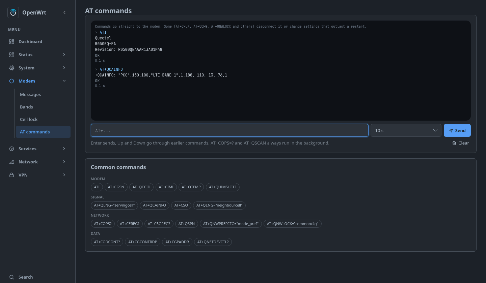

# AW1000_NSS_BYTE

Firmware for the **Arcadyan AW1000**: the aw1000-feed modem stack (XT) plus
the BYTE runtime (TTL/HopLimit rewrite, MTU clamp, IPv6 sanity, self-check,
RJ11 phone port), on the NSS-EDMA tree with **apk** as the package manager.

- Base: `JuliusBairaktaris/openwrt-ppe-nss`, branch `nss-edma-rework`
- NSS feed: `xhikarishii/nss-packages`
- Theme: footstrap + the luci-mod-dashboard widgets
- Package manager: apk (`--allow-untrusted`; packages are unsigned)
- Proxy: passwall2 **26.4.10** with **Xray-core 26.3.27** installed by
  default; Nikki and OpenClash are carried in the feeds (with their runtime
  deps already in the image) and can be installed from LuCI afterwards -
  never two at once
- Also in the image: SQM, netstat, vnstat2, modeminfo, the RJ11 phone stack,
  and the one-click AdGuard Home + PassWall2 setup page
- **Not** in the image, built and published as feed packages only: AdGuard
  Home, Tailscale, the AW1K LED controller, Nikki and OpenClash - install any
  of them with `apk add --allow-untrusted` (see "Built, published, not in the
  image" below)
- Defaults: LAN `192.168.1.1`, SSID `BYTE` (open), root password empty

## Screenshots

Dashboard with the modem, temperature and NSS offload widgets:



| Mobile tab | SMS |
|---|---|
|  |  |
| **Cell lock** | **Bands** |
|  |  |



Phone numbers, SIM and modem identifiers, addresses, cell IDs and the TAC
are masked.

## Packages

| Package | What it is |
|---|---|
| `kmod-qmi_wwan_q` | Quectel QMI WWAN driver 1.5.0 with QMAP multiplexing. Default `qmap_mode` is a menuconfig option (`QMI_WWAN_Q_QMAP_MODE`, default 2 → `wwan0_1`, `wwan0_2`). Built **without** its own rmnet_nss hooks: `qca-nss-drv` binds raw-IP modem netdevs itself (nss-packages `944ea25`), so the QMAP netdevs are always raw IP. See [docs/wwan-nss-offload.md](docs/wwan-nss-offload.md). |
| `quectel-cm` | quectel-cm 1.6.5 + netifd `quectel` proto: IPv4/IPv6 over separate QMAP channels (`option multiplexing 1`), passthrough, NAT64, handover monitor. |
| `luci-proto-quectel` | LuCI form for the `quectel` proto. |
| `luci-app-aw1000-modem` | The Modem pages (below): SMS conversations, bands, cell scan and lock, AT console. Ships `aw1000-at`, which sends one AT command and waits as long as it needs. |
| `udp-broadcast-relay-redux` | Relays UDP broadcasts between networks (e.g. Tapo camera discovery on port 20002 across lan/iot). Removed from openwrt/packages in `90b98c14f` (upstream archived); vendored unchanged. |
| `aw1000-defaults` | First-boot settings: `wwan` interface (APN `internet`, IPv4), front-panel LEDs, USB drive automount (`/mnt/<device>`), Footstrap theme. Runs once (marker `system.@system[0].aw1000_defaults`). Also ships `aw1000-leds`, `aw1000-modem-ports` and the dashboard widgets (below). |

| `ubus-at-daemon` | Ubus AT command daemon (`ubus call at-daemon sendat`). Vendored from FUjr/QModem `052f8447` (MPL-2.0), because fxsd drives the phone through it and the QModem repo is not a feed here. AT port defaults to `/dev/ttyUSB3`. |
| `kmod-aw1000-fxs` / `fxsd` / `luci-app-fxs` | The RJ11 phone port: SLIC kernel module, the daemon (DTMF, ringing, caller ID) and its LuCI page. From `Perz3us/openwrt-aw1000-phone`. |

`qmi_wwan_q` is Quectel's V1.5.0 as carried by FUjr/QModem `c49654e`
(builds on Linux 6.17+). `quectel-cm` and `luci-proto-quectel` are taken from
[xhikarishii/nss-packages](https://github.com/xhikarishii/nss-packages)
branch `aw1000-nss` at `ef05f5c` (GPL-2.0).

## Front panel

| LED | Meaning |
|---|---|
| signal (RGB) | LTE RSRP (the anchor on 5G NSA); steady green on 5G SA; off = no service |
| 5G (RGB) | NR RSRP on 5G SA or NSA; off on LTE only |
| internet | steady while fiber (`wan`) or the modem (`wwan`) can ping 1.1.1.1 / 8.8.8.8 |
| Wi-Fi | steady while the 5 GHz AP (`phy0-ap0`) is up |
| phone | blinks while there are messages not yet listed on Modem → Messages |

Quality colours: green ≥ −90 dBm, blue ≥ −105, red below.

Signal, 5G, internet and phone are driven by the `aw1000-leds` service, which
every 10 s polls `AT+QENG="servingcell"` and `+CPMS?` on the modem's second AT
port and pings out of each of `internet_ifaces` (`/etc/config/aw1000_leds`).

## Modem pages

LuCI's Modem menu is `luci-app-aw1000-modem`:

| Page | What |
|---|---|
| Messages | SMS as conversations: modem and SIM memory (a fill bar each), long messages put together, sent ones kept on the router (`/etc/aw1000-modem/sms-sent`); where new messages are stored (modem or SIM) |
| Bands | network mode, 5G NSA/SA, and the LTE / 5G NSA / 5G SA bands (`AT+QNWPREFCFG`), the ones in use marked |
| Cell lock | serving cell, LTE and 5G SA cell locks, neighbour list, full scan of every operator's cells (`AT+QSCAN`, about 100 s) |
| AT commands | console with history and common commands; slow ones run in the background |

The backend is the rpcd plugin `luci.aw1000-modem`. Settings are in
`/etc/config/aw1000_modem`: the cell locks, which the `quectel` proto sends
to the modem on every connect (they used to be its `cell_lock_4g` option),
the SMS country code (`0917…` is sent as `+63917…`: Smart's SMS centre
refuses national numbers) and the storage for new messages, which
`aw1000-leds` restores after a modem restart.

Every AT user takes the modem's lock, `/var/lock/aw1000-modem.lock`: all
ports lead to one command parser. The AT ports are chosen by USB interface,
not by `ttyUSB` number (`aw1000-modem-ports`): interface 2 for the pages,
interface 3 for `aw1000-leds`. A modem reset that renumbers the ports
(`ttyUSB3` → `ttyUSB4`) needs no manual fix.

## Dashboard widgets

`aw1000-defaults` adds widgets to `luci-mod-dashboard` (plain files in its
`view/dashboard/include/`, no patch):

| Widget | Card | Chart | Tab |
|---|---|---|---|
| `mobile` (`40_mobile.js`) | LTE / 5G NSA / 5G SA, operator, bands, RSRP, connected or standby | LTE and 5G RSRP and SINR, last 5 min | carriers (band, bandwidth, PCI, ARFCN, RSRP/RSRQ/SINR), cell ID, TAC, APN, addresses, band and cell locks (linked to the Bands and Cell lock pages), SIM, firmware, modem temperature |
| `mobile-traffic` (`40_mobile.js`) | | down/up over `wwan0_N`, NSS-offloaded traffic included | |
| `thermal` (`45_thermal.js`) | CPU, NSS, Wi-Fi, modem °C | the same, last 5 min | |
| `nss` (`48_nss.js`) | connections offloaded to the NSS firmware (ECM, IPv4 / IPv6) | the same, last 5 min | |

The modem takes one AT command at a time, so the widgets never query it: `aw1000-leds` saves its replies and the temperatures to
`/tmp/aw1000-status/` every poll (`live`, `static` once a minute, `history`,
`thermal`, `nss`), and the widgets read those files (ACL
`luci-aw1000-dashboard`). Parsing and the signal icons are shared with the
modem pages in `aw1000/cell.js`; a reading's colour gives its quality (good,
fair, poor), named in its tooltip. The NSS firmware's load figure
(`stats/cpu_load_ubi`) is not shown: qca-nss-drv only refreshes it while
the NSS clock scales itself, which this build leaves off, so it stays at its
boot value. A saved layout (Dashboard → Layout) lists widgets
by id; new ids only show once added there.

## Build

No containers: `build/build.sh` clones the pinned trees into `work/` and
builds natively. On Ubuntu/Debian install OpenWrt's build dependencies first
(the same list `.github/workflows/build.yml` installs).

```sh
build/build.sh            # fetch pinned trees, feeds, config, full build
build/build.sh prepare    # stop after .config + overlay (no make)
build/build.sh make menuconfig
build/build.sh make -j$(nproc)
build/build.sh clean      # remove work/
```

CI (`.github/workflows/build.yml`) runs the same script on push to `main`;
images are uploaded as the `aw1000-nss-byte-images` artifact. `work/openwrt/dl`
and `work/openwrt/.ccache` are cached between runs.

All trees are pinned to full 40-char SHAs in `build/versions`; bump one line
at a time - the patches fail loudly (not silently) when they stop applying.

- `build/feeds` — feeds added to `feeds.conf.default`, in install order.
- `build/feeds.prefer` — packages taken from a given feed when several carry
  them (`sms-tool` from 4IceG's repo).
- `build/feeds.exclude` — installed feed packages removed again.
- `build/config` — appended to `builder-reference/devices/common/config`.
- `build/versions` — pinned SHAs for the base tree, nss feed and builder ref.
- `byte/files/` — the BYTE runtime overlay (below), copied into the image.
- `build/patches/<feed>/` — patches applied to `feeds/<feed>`.
- `build/patches-openwrt/` — patches applied to the OpenWrt tree itself.

aw1000-feed shipped two extra `qca-nss-drv` patches (0119/0120) that patched
`nss_rmnet_rx_bind_xmit()`. That function does not exist in the nss-drv source
any branch of `xhikarishii/nss-packages` pins (`d5ee67b`, 783-line
`nss_rmnet_rx.c`), and no feed patch creates it - the raw-IP path in this
source goes through `xmit_cb` in `nss_core.c` instead. Both patches were
dropped: they can never apply, and inside.sh aborts on a patch that does not
apply rather than silently skipping it.

## BYTE runtime (`byte/`)

Ported from `Ace1337z/AW1000_BYTE` and adapted from qmodem to this image's
quectel-cm + `qmi_wwan_q` data path.

| Piece | What it does |
|---|---|
| `etc/init.d/byte-ttl` | TTL/HopLimit rewrite for modem egress. An `inet forward` chain at priority `mangle`, matching the **output** interface (`wwan0_1`, `wwan0_2`) rather than `iifname br-lan`, so only traffic actually leaving through the modem is touched. Config in `/etc/config/byte_ttl` (`ttl`, `ttl4`, `hl6`, `meta_mode`). Writes `/etc/nftables.d/90-byte-ttl.nft`. |
| `etc/init.d/byte-mtu` + `90-byte-mtu` | Clamps `wwan0`/`wwan0_1`/`wwan0_2` to MTU 1420. A 1500-byte MTU on an LTE/NR bearer is a PMTU blackhole: full-size packets are dropped upstream while small ones pass, which stalls large transfers and VoIP. Re-applied on every `ifup`. |
| `etc/init.d/byte-v6` + `byte-v6-check` | Keeps IPv6 enabled, but demotes it to IPv4 when the carrier delegates a prefix with no routable WAN address. Without it clients prefer a dead IPv6 path and "the internet is fine but nothing loads". |
| `etc/init.d/byte-affinity` | Spreads modem packet processing (RPS/XPS on `wwan*`, `rmnet*`, `br-lan`) across all four cores. The modem's USB interrupts otherwise all land on one core, which saturates long before the link does once passwall2 is doing userspace crypto. |
| `etc/init.d/byte-selfcheck` | Verifies the tuning at boot and on every `ifup`: governor pinned, `fq`/`bbr`, MTU probing, conntrack and socket buffer ceilings. Logs `byte-selfcheck: OK` or the mismatches - it does not fail the boot. |
| `etc/vnstat.conf` | vnStat with `DatabaseDir "/etc/vnstat"`. The package default is `/var/lib/vnstat`, which is tmpfs: the database and every monthly/yearly total is lost on reboot. `/etc` is the persistent overlay. |
| `etc/uci-defaults/99-byte` | One-shot runtime defaults, guarded by `system.@system[0].byte_defaults`. Named `99-` so it runs *after* the NSS feed's `98-nss-offload`, which is what makes the `packet_steering=1` override stick. |
| `etc/init.d/byte-tailscale-gate` + `byte-ts-should-start` | Starts `tailscaled` only once a state file with real credentials exists, instead of holding ~13 MB of private RSS on routers that never use it. Fails open: anything ambiguous means start. |
| `usr/bin/nss-offload` | `nss-offload on\|off\|status` toggles NSS/ECM flow offload. **Off by default**: ECM bypasses netfilter, so offloaded flows keep their original TTL and defeat the rewrite. |
| `etc/rc.local` | Every boot: re-asserts the TTL service and ECM-off, then brings up the RJ11 phone port in the background (PCM slave check via `AT+QDAI`, waits for the `at-daemon` ubus object, starts `fxsd`) and self-heals `tailscale0` when it comes up with no address. |
| `etc/sysctl.conf` | `fq`/`bbr`, MTU probing, 4 MB socket buffers and 32768 conntrack entries - sized from the bandwidth-delay product of a 300 Mbit/s, 60 ms link, not from server defaults. |
| `etc/config/wireless` | SSID `BYTE`, open, both radios on, 5 GHz HE80 ch149 / 2.4 GHz HE20 ch1. |
| `etc/config/system` | Hostname `AW1000`, zram on `lzo-rle` (the only algorithm this kernel ships), NTP. |

Deliberately **not** carried over from BYTE: the hourly `drop_caches` +
`swapoff/swapon` cron (it throws away a warm page cache and stalls every
process touching zram), the ImmortalWrt opkg feed script (this image is apk),
and `qmodem-iface-heal` (quectel-cm does not delete `network.wan` on redial).

`etc/uci-defaults/98-byte` applies the runtime defaults once, guarded by
`system.@system[0].byte_defaults`, so it survives a settings-keeping
sysupgrade. Clear that option to have it re-applied:

```sh
uci delete system.@system[0].byte_defaults && uci commit system
```

## Installing packages

The image uses **apk**. Feed packages built here are unsigned, so install
them with:

```sh
apk add --allow-untrusted <package>
```

Nikki and OpenClash are carried in the tree but not installed, because they
install the same TPROXY/nftables hooks as passwall2. Only one of the three may
be active at a time.

## Cellular offload (NSS)

Two halves, both required, and both are in `build/config`:

1. `CONFIG_NSS_DRV_RMNET_ENABLE` + `CONFIG_NSS_DRV_C2C_ENABLE` build
   `qca-nss-drv`'s `rmnet_rx` node support and give the n2h node its core-1
   hop.
2. `CONFIG_PACKAGE_kmod-rmnet-nss` builds the `rmnet-nss` module from the nss
   feed's `wwan/driver/rmnet-nss`. It publishes `rmnet_nss_callbacks`, and
   `rmnet_nss_xmit()` is what strips the 14-byte Ethernet header the firmware
   adds to accelerated uplink packets.

`rmnet-nss` only exists on the nss feed's `aw1000-nss` branch, which is why
`build/versions` pins that branch rather than `NSS-12.5-K6.x`.

What this image does **not** do is wire `qmi_wwan_q`'s own rmnet_nss hooks:
that needs `-DCONFIG_QCA_NSS_DRV`, and the package deliberately does not pass
it, because the driver's own hook would claim the same `rx_handler` the
`qca-nss-drv` binder wants. So the modem path runs on the CPU. That is also
what XT-Martinez's proven `aw1000-feed` does - its `qmi_wwan_q` is
byte-identical to this one and its config sets the same two NSS symbols.

In practice this matters less than it sounds: `byte-ttl` keeps ECM off by
default, because ECM bypasses netfilter entirely and offloaded flows would
keep their original TTL. Offload and TTL rewriting are mutually exclusive on
this box; the image chooses TTL. Run `nss-offload on` to trade one for the
other.

## Proxy versions

| Package | Version | Source |
|---|---|---|
| `luci-app-passwall2` | 26.4.10 (tag `26.4.10-1`) | `Openwrt-Passwall/openwrt-passwall2` |
| `xray-core` | 26.3.27 | `xiaorouji/openwrt-passwall-packages` @ `d0ebdbb` |
| `sing-box` | 1.13.4 | same |
| `chinadns-ng` | 2025.08.09 | same |

The passwall dependency feed is pinned at the commit that carries Xray 26.3.27
(`d0ebdbb`, "xray-core: update to 26.3.27") rather than at its branch head,
which carries a much newer Xray. Bumping `PASSWALL_PKGS_SHA` in
`build/versions` moves Xray; keep it in step with the passwall2 tag.

Nikki (sing-box/mihomo) and OpenClash are **not** installed, but everything
they need at runtime is: `yq`, `bash`, `ruby`, `ruby-yaml`, `kmod-tun`,
`kmod-nft-tproxy`, `kmod-nft-socket`, `kmod-inet-diag`, `ip-full`, `curl`,
`ca-bundle`, `dnsmasq-full`. Installing one of them does not pull a dependency
tree, and only one of the three may be active at a time - they all install the
same TPROXY/nftables hooks.

QUIC/HTTP3 works through all three: the conntrack helper, `nf-tproxy` /
`nft-tproxy` and `nf-socket` / `nft-socket` are built in, and
`filter_aaaa`/`filter_a` are off in `etc/config/dhcp` so HTTPS/SVCB records
reach the clients.

## IPv6

**On by default, with a measured demotion.** `network.wwan` is dual-stack:

```
option pdptype 'ipv4v6'
option multiplexing '1'
option delegate '1'
```

IPv4 rides `wwan0_1`, IPv6 rides `wwan0_2` (that is what `qmap_mode=2` is for),
and the IPv6 call comes up as the dynamic `wwan_6`, which the wan firewall zone
lists alongside `wwan`. The LAN runs `ra server`, `dhcpv6 server`,
`managed-config` + `other-config` and `master 1`, so clients get both a prefix
and a lease.

Being *available* is not the same as *working*: plenty of carriers delegate a
prefix and never route it. `byte-v6-check` handles that by measuring rather
than guessing - it waits for `wwan`/`wwan_6`, then makes real `wget -6`
connections to three literal targets (two IPv6 literals and one hostname,
so a broken resolver is distinguished from broken routing). Only if all of
them fail does it demote:

- writes `/etc/gai.conf` so `getaddrinfo` prefers IPv4
- disables LAN `ra`/`dhcpv6` so clients stop being handed a dead prefix
- flushes the ULA source off `br-lan`
- installs a `metric 2048` default route so IPv4 wins

It re-runs on every `ifup`, and `restore_ipv6` undoes all of it when a later
connection turns out to work. Nothing is permanent: a carrier that fixes its
IPv6 gets IPv6 back on the next reconnect.

## Packet steering

**Off**, matching the NSS feed's `98-nss-offload` default. Its comment records
the measurement on this board (Wi-Fi client to wired host through the router,
two runs each): 749 and 800 Mbit/s with the service disabled against 619 and
626 with it on, plus `n2h_rx_queue` drops (158 and 83) where disabling it
produced none. Linux RPS assumes one host NAPI per hardware queue, which does
not describe a datapath where the firmware delivers through N2H - the NSS
already spreads work over its queues, so steering duplicates it.

Turn it on by hand if you want it:

```sh
uci set network.@globals[0].packet_steering='1'
uci commit network && /etc/init.d/packet_steering restart
```

`byte-affinity` still spreads the modem's USB interrupts and sets RPS on the
`wwan*` netdevs. That is the part that matters for cellular throughput, and it
does not touch the NSS delivery path.

## Image size

The sysupgrade image is what gets flashed, and `build/inside.sh` prints its
size, the rootfs size and the ten largest files at the end of every build, so
a regression is visible in the log rather than at flash time.

What trims the image without changing behaviour:

- `CONFIG_SQUASHFS_XZ=y` - `image.mk` then runs `mksquashfs` with
  `-comp xz -Xpreset 9 -Xe` instead of gzip. Per-block decompression cost only,
  not whole-image.
- 256 KiB squashfs blocks (the tree default): 1 MiB compresses better but
  multiplies read amplification for LuCI's many small files.
- Only squashfs + initramfs as rootfs formats.
- `KALLSYMS_ALL` off (already the generic default; pinned so a rebase cannot
  flip it).
- PPP/PPPoE/L2TP/PPTP and the tunnel helpers are off - this box dials QMI.
- Foreign wireless (ath10k/mt76/rtw88/rtw89), bluetooth, audio, SATA/NVMe, and
  the NFS/CIFS/F2FS filesystem modules are off.
- Debug/profiling tools (gdb, strace, perf, valgrind, tcpdump, lsof) are off.
- LuCI translations stay out: they are `HIDDEN` with
  `DEFAULT:=LUCI_LANG_<tag>||(ALL&&m)` and the builder sets `CONFIG_ALL_KMODS`,
  not `CONFIG_ALL`.

Deliberately **kept** even though they look like candidates:
`kmod-usb-wdm` (a hard dependency of `qmi_wwan_q`), `kmod-scsi-core`
(`usb-storage` needs it), `kmod-fs-squashfs` (the rootfs), and the crypto
hash/crc32c modules (WireGuard, Tailscale, the NSS stack).
`CONFIG_STRIP_KERNEL_EXPORTS` is **not** used: it depends on `BROKEN` in this
tree, so defconfig would drop it and the symbol-verification step would fail
the build.

## LuCI apps in the image

Eleven `luci-app-*` packages are in the image. Everything else LuCI-side is a
library (`luci-lib-jsonc`, `luci-compat`), a protocol handler (`luci-proto-*`),
the theme, or the dashboard module.

| App | What it is | Source |
|---|---|---|
| `luci-app-aw1000-modem` | Modem pages: SMS conversations, bands, cell scan and lock, AT console | this repo |
| `luci-app-modeminfo` | Serving-cell / SA info page | vendored from AW1000_BYTE |
| `luci-app-fxs` | RJ11 phone port: dialling, history, caller ID | Perz3us/openwrt-aw1000-phone |
| `luci-app-agh-passwall2` | One-click AdGuard Home + PassWall2 DNS setup | wraps Ace1337z/openwrt-agh-passwall2 |
| `luci-app-passwall2` | Proxy (26.4.10, Xray 26.3.27) | Openwrt-Passwall |
| `luci-app-sqm` | Smart Queue Management | openwrt/luci |
| `luci-app-netstat` | Live per-interface counters + connections | Ace1337z |
| `luci-app-vnstat2` | Long-term traffic graphs (`vnstat2`, `vnstati2`) | openwrt/luci |
| `luci-app-ddns` | Dynamic DNS | openwrt/luci |
| `luci-app-wol` | Wake-on-LAN (`etherwake` included, the app does not pull it) | openwrt/luci |
| `luci-app-footstrap-files` | File manager for the Footstrap theme | VizzleTF |
| `luci-mod-dashboard` | Status -> Dashboard page (the modem/thermal/NSS widgets) | openwrt/luci |
| `luci-theme-footstrap` | The theme itself | VizzleTF |

Plus `luci-proto-quectel` (the `quectel` netifd protocol form) and
`luci-proto-wireguard`.

### Built, published, not in the image

These are compiled and published next to the image so `apk add` works on a
running router, but they are not baked in - each is either large or mutually
exclusive with something the image already does:

| Package | Why it is not in the image | Install with |
|---|---|---|
| `adguardhome` + `luci-app-adguardhome` | ~30 MB Go binary plus a web root, for a minority use case. It also wants to own port 53, which passwall2 already uses. | `apk add --allow-untrusted adguardhome luci-app-adguardhome`, then use **Services → AdGuard + PassWall2** (that page wires the DNS chain for you) |
| `tailscale` + `luci-app-tailscale-community` | `tailscaled` is ~13 MB of private RSS. `byte-tailscale-gate` is already installed and starts it only once credentials exist, so installing later behaves identically. | `apk add --allow-untrusted tailscale luci-app-tailscale-community` |
| `luci-app-aw1k-led` | Its `led-status` daemon writes the same `blue:5g`/`blue:signal`/`green:wifi` sysfs entries as `aw1000-leds`, so only one may run. `aw1000-leds` keeps the panel. | see the comment in `build/config` |
| `luci-app-nikki` | Installs the same TPROXY/nftables hooks as passwall2. One proxy at a time. | `apk add --allow-untrusted luci-app-nikki` |
| `luci-app-openclash` | Same conflict as nikki. | `apk add --allow-untrusted luci-app-openclash` |
| `luci-app-nft-ttl` | Writes its own `ttl64.nft` and a `br-lan` postrouting rule; `byte-ttl` already owns the modem egress rewrite. Excluded in `feeds.exclude`. | drop that line and rebuild |
| dotycat QoL (`luci-app-nssinfo`, `luci-app-dstore`, `luci-app-occ`) | Optional extras, no conflict. | `apk add --allow-untrusted <name>` |

Every dependency those packages declare is already in the image (checked against
each Makefile), so installing one does not pull a dependency tree.

## The RJ11 phone port does not need QModem

**Short answer: yes, it works without qmodem. It needs `ubus-at-daemon`, which
this image vendors.**

The confusion is understandable - the fxs project's README says "QModem (fxsd
sends AT commands through its at-daemon)", and at-daemon is a package from the
QModem repo. But the dependency is on the *daemon*, not on QModem the modem
manager. Nothing in fxsd talks to QModem's config, its dial worker or its
`network` sections.

The whole chain, verified in the source:

| Piece | Where it comes from | Why |
|---|---|---|
| `kmod-aw1000-fxs` | fxs feed | the SLIC driver (si3226x over SPI/PCM) |
| `fxsd` | fxs feed | dial tone, ringing, DTMF, caller ID |
| `luci-app-fxs` | fxs feed | the LuCI page |
| `ubus-at-daemon` | vendored in `aw1000/` | the AT transport fxsd uses |
| `kmod-usb-serial-option` | `quectel-cm`'s dependency | creates `/dev/ttyUSB*` |
| AT port | resolved at boot by USB interface 02 | see below |

`fxsd` sends **every** AT command through `ubus call at-daemon sendat` (see
`modem_at()` in `fxsd/src/modem.c` - unconditional, no fallback). Its direct
tty code (`at_ready()`) is only a liveness probe, never a command path. So
without at-daemon the phone sits at "Waiting for the modem" even though the
modem answers `sms_tool` fine.

That daemon is ~100 KB and does one thing: open a tty, write an AT command,
read the answer back over ubus. It has no relationship to QModem's data path,
which is why vendoring it is enough and pulling the QModem feed is not.

### AT port

`fxsd` finds the port itself by USB interface number (`AT_IFACE 2`, Quectel VID
`2c7c`), not by ttyUSB name, because a port held open across a modem reset can
come back as a different number. `99-zz-at-daemon-port` applies the same lookup
to the daemon's config, and `rc.local` uses it for the PCM probe, so all three
agree even after a reset.

XT-Martinez's feed has no phone stack at all, so there is nothing there to
compare against; the requirement comes from fxsd itself.

## Upstream status

`openwrt-ppe-nss` branch `nss-edma-rework` is **archived** upstream. Its README
points at the `ppe-nss` branch (kernel 6.18, PPE instead of EDMA, NSS packages
moved into the feed, no `package/nss/nss-tools` in the tree).

This repo stays on the archived branch because XT-Martinez's `aw1000-feed` -
the proven build it follows - is built on exactly this tree, and every package
under `aw1000/`, `wwan/` and `net/` is byte-identical to his. Moving to
`ppe-nss` is not a version bump: `build/patches-openwrt/0002` patches
`package/nss/nss-tools`, which does not exist there, and the feed set would
need re-testing end to end.

If you do migrate, the work is: repoint `OPENWRT_SHA` and `NSS_PACKAGES_*` at
`ppe-nss`, rewrite 0002 against the feed's `nss-tools`, drop 0003 if the new
tree no longer pulls `uqmi`, and re-verify that `kmod-qmi_wwan_q`,
`kmod-rmnet-nss` and the fxs SLIC module still build on 6.18.
